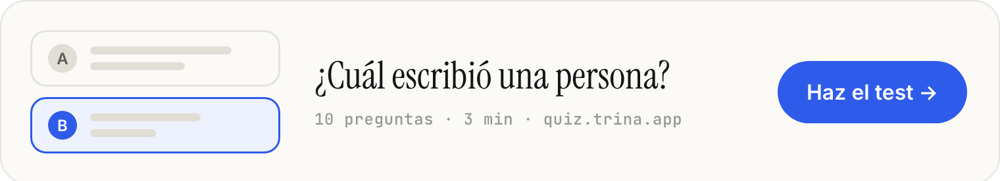
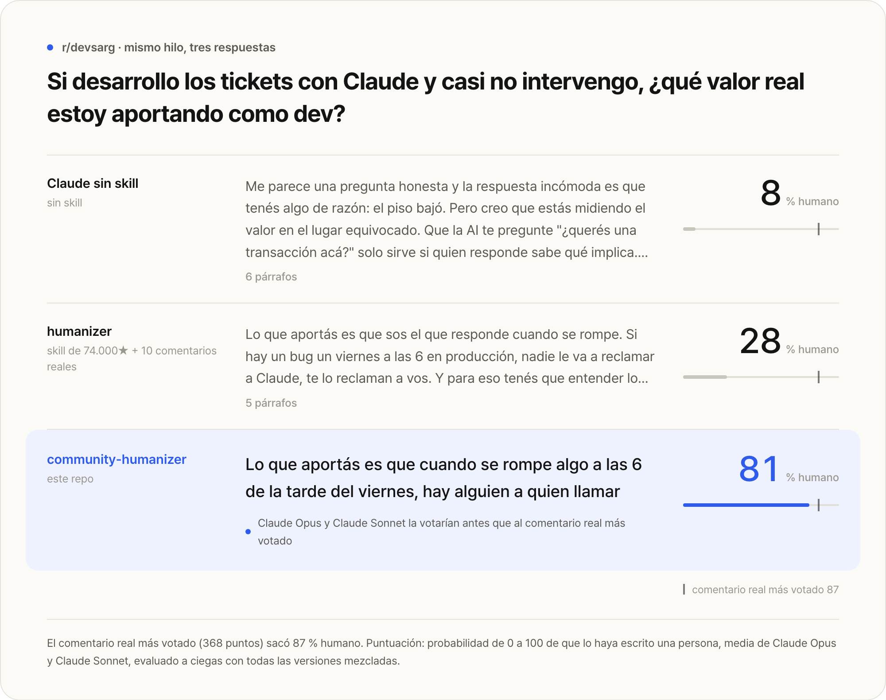
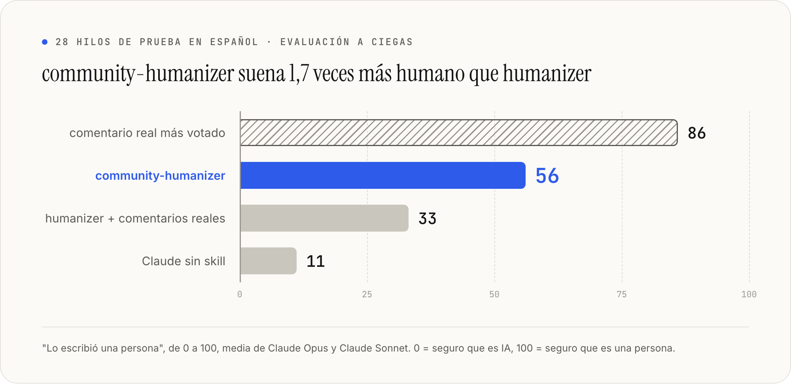

<h1 align="center">community-humanizer</h1>

<p align="center">
  <b>Los humanizers hacen que un texto suene menos a IA.<br>Este hace que suene a la gente que de verdad participa ahí.</b>
</p>

<p align="center">
  Una skill de Claude Code que escribe respuestas de Reddit como las escriben los habituales de cada subreddit. Nunca publica nada.
</p>

<p align="center">
  <a href="https://quiz.trina.app/?lang=es"><picture><source media="(prefers-color-scheme: dark)" srcset="docs/img/quiz-es-dark.png"></picture></a>
</p>

<p align="center">
  
  
  <a href="benchmark/"></a>
</p>

<p align="center">
  <a href="#mismo-hilo-tres-respuestas">Ejemplo</a> ·
  <a href="#funciona">Resultados</a> ·
  <a href="#instalación">Instalación</a> ·
  <a href="#test">Test</a>
</p>

<p align="center">
  <a href="README.md">English</a> · <a href="README.ko.md">한국어</a> · <a href="README.zh-CN.md">中文</a> · <b>Español</b> · <a href="README.id.md">Bahasa Indonesia</a>
</p>

---

## Mismo hilo, tres respuestas

<picture>
  <source media="(prefers-color-scheme: dark)" srcset="docs/img/thread-es-dark.png">
  
</picture>

<p align="center"><sub><a href="https://www.reddit.com/r/devsarg/comments/1xynq5l/">El hilo</a> · puntuaciones en <a href="benchmark/spanish-comments/judged">benchmark/spanish-comments/judged</a></sub></p>

## ¿Funciona?

<picture>
  <source media="(prefers-color-scheme: dark)" srcset="docs/img/scores-es-dark.png">
  
</picture>

Dos jueces de IA (Claude Opus y Claude Sonnet) vieron a la vez todas las respuestas de cada hilo, cada uno en su propio orden aleatorio, y puntuaron de 0 a 100 la probabilidad de que cada una la hubiera escrito una persona. Los 28 hilos vienen de r/devsarg, r/programacion, r/preguntaleareddit, r/askspain y r/mexico, y ninguno se usó para ajustar los prompts. Los prompts de la skill están en inglés y no se cambió ni una palabra para el español. Se comparó con [humanizer](https://github.com/blader/humanizer) (74.000 estrellas), al que se le dieron 10 comentarios reales del mismo subreddit. El criterio de aprobado se dejó por escrito antes de la prueba. Puntuaciones por juez, intervalos de confianza y todos los textos generados: [benchmark/spanish-comments/RESULTS.md](benchmark/spanish-comments/RESULTS.md). Las pruebas en inglés y coreano están en [benchmark/RESULTS.md](benchmark/RESULTS.md).

Lo que esto no demuestra:
- **Todos los jueces son IA.** Todavía no hay respuestas de personas. Para eso está el [test](#test).
- **No hubo juez GPT.** El protocolo preveía tres jueces, pero GPT no se ejecutó por el límite de uso, así que aquí solo están Claude Opus y Claude Sonnet. Con los dos, community-humanizer supera a humanizer (por 21 y 24 puntos, con el intervalo del 95 % por encima de cero).
- **La mayoría de las veces todavía se nota.** El comentario real saca 86 de media y community-humanizer, 56. Opus no la vio más humana que el comentario real en ninguno de los 28 hilos. Sonnet, en 2.
- **Las respuestas siguen siendo largas.** La mediana es de 48 palabras, frente a 17 del comentario real.
- **r/askspain prohíbe el contenido generado por IA.** Sus hilos están en la prueba porque no se publicó nada, pero la herramienta no escribe ahí. Sin r/askspain, la diferencia casi no cambia (22 y 24 puntos).

## Lo que aprendimos

- **Lo corto gana a lo pulido.** En los 28 hilos, el comentario real más votado tiene una mediana de 17 palabras. Claude sin la skill escribe 280, humanizer 115 y community-humanizer 48.
- **Un solo párrafo hizo casi todo el trabajo.** Un personaje que escribe corto y sin esforzarse mucho, que no lo sabe todo y no finge saberlo (a partir de Jones & Bergen 2025). Está tal cual en [prompts.mjs](skills/community-humanizer/lib/prompts.mjs).
- **Corregir lo que el juez decía que delataba a la IA bajó la puntuación.** En la prueba en inglés, Opus señaló los cierres demasiado redondos y la informalidad fingida. Quitar justo eso costó entre 12 y 20 puntos. Lo que el juez dice y lo que de verdad mira no son lo mismo.
- **Meter erratas a propósito no sirve.** En la prueba en inglés, los textos reales casi no tenían (1–2 %). Lo que sí funcionó fue escribir como quien teclea en el móvil, en el orden en que se le ocurren las cosas.

## Lo que no hace

- **Publicar por ti.** Lees el borrador, corriges lo que no sea cierto para ti y lo publicas tú.
- **Inventar experiencias.** Tu propia historia solo entra con `--fact "..."` (respuestas) o con tus notas (publicaciones), y las publicaciones se cotejan con tus notas.
- **Escribir en hilos políticos.** Primero un modelo pequeño revisa el hilo. Si no queda claro que no es político, lo rechaza.
- **Escribir donde el texto de IA está prohibido.** Cada perfil de subreddit trae sus reglas. Rechaza los subreddits que prohíben el contenido generado por IA (por ejemplo, r/askspain) y te muestra las reglas de autopromoción antes de que publiques.

## Instalación

| Agente | Instalación |
| --- | --- |
| **Claude Code** | `/plugin marketplace add trina-app/community-humanizer` y después `/plugin install community-humanizer@community-humanizer` |
| **Codex, Cursor, Gemini CLI, Copilot** y otros agentes compatibles con [Agent Skills](https://agentskills.io) | `npx skills add trina-app/community-humanizer -g` |
| **Cualquier agente que pueda ejecutar comandos** | Pega el prompt de abajo |

```text
Set up community-humanizer for me: clone https://github.com/trina-app/community-humanizer,
read skills/community-humanizer/SKILL.md, and follow it whenever I ask for a Reddit reply or post.
```

Después pídeselo con tus propias palabras: "responde a este hilo: <url>" o "escribe una publicación para r/devsarg sobre ...".

Uses el agente que uses, necesitas Node 18 o superior y [Claude Code](https://claude.com/claude-code) instalado y con la sesión iniciada: los borradores se escriben con llamadas a `claude -p`.

<details>
<summary>Desde un clon del repositorio, en la terminal</summary>

```bash
node skills/community-humanizer/bin/voice.mjs reply <url del hilo de reddit> [--point "lo que quieres decir"]
node skills/community-humanizer/bin/voice.mjs post --to r/selfhosted --title "Is a Mac mini enough for Immich?" --notes "400GB of photos, M2 mini 16GB unused, also Jellyfin for 3 people, macOS or Linux on an old PC?"
```

</details>

## Cómo funciona

**Respuestas**
1. Lee unos diez hilos con mucha actividad del mismo subreddit de las últimas dos semanas. Los saca del archivo gratuito [Arctic Shift](https://arctic-shift.photon-reddit.com). El hilo al que respondes nunca se usa como muestra.
2. Clasifica sus comentarios más votados por tipo: respuesta, frase corta, desacuerdo, contrapregunta, comentario al margen, broma, queja.
3. Sortea tres tipos con las frecuencias reales de ese subreddit y escribe un borrador de cada uno. Cada borrador sale de una llamada a Claude por separado, con comentarios reales de ese tipo de ejemplo.
4. Un modelo más pequeño elige el que más parece escrito por un habitual. También recibes los otros dos.

El personaje está adaptado del que hizo que GPT-4.5 pasara por humano el 73 % de las veces en un test de Turing con tres participantes ([Jones & Bergen, 2025](https://arxiv.org/abs/2503.23674)). Aquel test era un chat. Lo reescribimos para respuestas de foro y lo medimos a ciegas (los resultados están arriba).

**Publicaciones:** le das la idea en notas. Escribe la publicación como la teclearía un habitual en el móvil, a partir de seis publicaciones reales de ese subreddit. Después comprueba que no diga nada que no esté en tus notas.

**Coste y tiempo:** una respuesta (tres borradores y la elección) cuesta unos 0,07 $ y tarda unos 13 segundos si escribe Opus, o 0,04 $ con `--fast` (Sonnet), según los precios de la API que muestra Claude Code. La primera vez en un subreddit, leerlo y clasificar sus comentarios lleva alrededor de un minuto, y el resultado se guarda en caché una semana.

## Test

**Juega aquí: [quiz.trina.app](https://quiz.trina.app/?lang=es)**

Son 10 preguntas en español, sacadas de los hilos de la prueba. Cada una trae dos respuestas y una de ellas la escribió una persona. Al final ves tu puntuación y cómo les fue a los demás.

Lo que contestas en el test se guarda de forma anónima (un ID de sesión aleatorio, sin IP), así por fin podremos decir con qué frecuencia la gente acierta. El código está en [quiz/](quiz/).

## Subreddits

Cada subreddit tiene un perfil pequeño en [communities/](communities/): con qué frecuencia aparece cada tipo de comentario, cuánto miden los comentarios y las publicaciones, y las reglas que importan. Añadir uno lleva un comando y un vistazo a la página de reglas. Mira [communities/README.md](communities/README.md) y mándalo en un PR.

## Benchmark

En [benchmark/](benchmark/) están el protocolo escrito antes de cada prueba, los scripts, todos los textos generados y la puntuación de cada juez. Los comentarios y las publicaciones reales no se redistribuyen: `ids.json` enlaza a cada hilo original. ¿Quieres probar tu propio humanizer con los mismos hilos? Abre un PR con los textos que genere.

## Licencia

MIT
