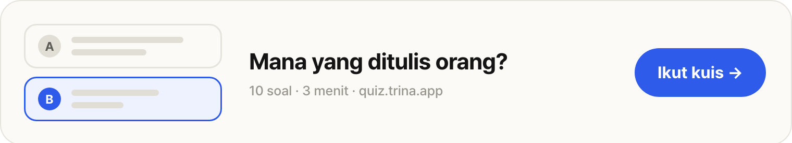
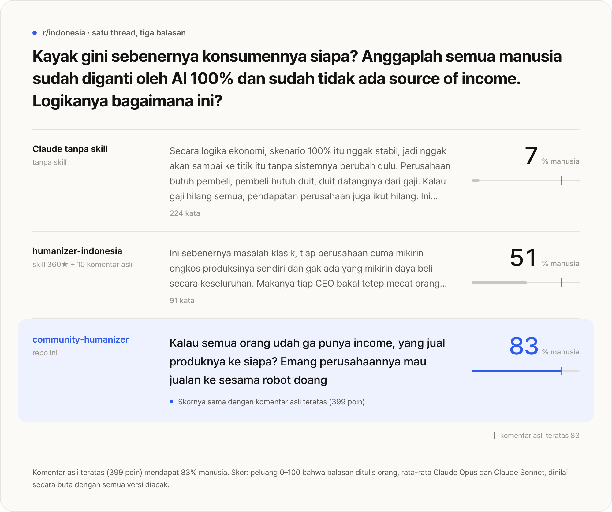
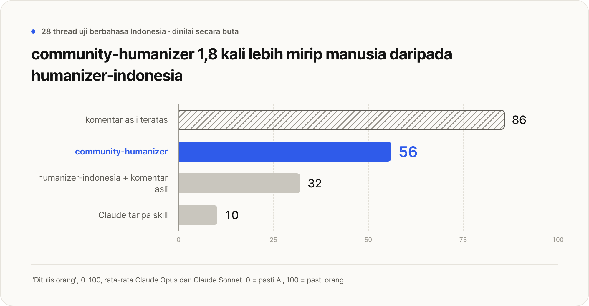

<h1 align="center">community-humanizer</h1>

<p align="center">
  <b>Humanizer biasa mengurangi kesan AI pada teks.<br>Yang ini membuatnya terdengar seperti anggota lama komunitas itu.</b>
</p>

<p align="center">
  Skill Claude Code yang menulis balasan Reddit dengan gaya anggota lama setiap subreddit. Tidak pernah memposting sendiri.
</p>

<p align="center">
  <a href="https://quiz.trina.app/?lang=id"><picture><source media="(prefers-color-scheme: dark)" srcset="docs/img/quiz-id-dark.png"></picture></a>
</p>

<p align="center">
  
  
  <a href="benchmark/"></a>
</p>

<p align="center">
  <a href="#satu-thread-tiga-balasan">Contoh</a> ·
  <a href="#hasilnya">Hasil</a> ·
  <a href="#instalasi">Instalasi</a> ·
  <a href="#kuis">Kuis</a>
</p>

<p align="center">
  <a href="README.md">English</a> · <a href="README.ko.md">한국어</a> · <a href="README.zh-CN.md">中文</a> · <a href="README.es.md">Español</a> · <b>Bahasa</b>
</p>

---

## Satu thread, tiga balasan

<picture>
  <source media="(prefers-color-scheme: dark)" srcset="docs/img/thread-id-dark.png">
  
</picture>

<p align="center"><sub><a href="https://www.reddit.com/r/indonesia/comments/1xrgz1c/">Thread aslinya</a> · skor dari <a href="benchmark/indonesian-comments/judged">benchmark/indonesian-comments/judged</a></sub></p>

## Hasilnya

<picture>
  <source media="(prefers-color-scheme: dark)" srcset="docs/img/scores-id-dark.png">
  
</picture>

Dua juri AI (Claude Opus dan Claude Sonnet) melihat semua balasan untuk satu thread sekaligus, masing-masing dengan urutan acaknya sendiri, lalu memberi tiap balasan skor 0–100: seberapa mungkin balasan itu ditulis orang. Ke-28 thread itu diambil dari r/indonesia, r/indotech, r/indonesiabebas, dan r/indowibu. Tidak satu pun dipakai saat menyetel prompt. Prompt skill ini berbahasa Inggris dan tidak diubah sedikit pun untuk bahasa Indonesia. Pembandingnya [humanizer-indonesia](https://github.com/adhiprib/humanizer-indonesia) (360 bintang), humanizer bahasa Indonesia dengan bintang terbanyak di GitHub. Skill itu juga diberi 10 komentar asli dari subreddit yang sama. Kriteria lulus sudah ditetapkan sebelum pengujian. Skor per juri, interval kepercayaan, dan semua teks yang dihasilkan: [benchmark/indonesian-comments/RESULTS.md](benchmark/indonesian-comments/RESULTS.md). Pengujian bahasa Inggris dan Korea ada di [benchmark/RESULTS.md](benchmark/RESULTS.md).

Yang belum terbukti dari angka ini:
- **Jurinya semua AI.** Belum ada jawaban dari manusia. Untuk itulah ada [kuis](#kuis).
- **Tidak ada juri GPT.** Pengujian bahasa Inggris dan Korea memakai tiga juri. Di sini hanya Claude Opus dan Claude Sonnet.
- **Masih sering ketahuan.** Rata-rata komentar asli mendapat 86, community-humanizer 56. Dari 28 thread, Opus hanya sekali menilainya lebih mirip manusia daripada komentar asli, Sonnet empat kali.
- **Kedua juri berbeda jauh.** Opus memberi community-humanizer rata-rata 46, Sonnet 66. Namun keduanya tetap menempatkannya di atas humanizer-indonesia, dengan selisih 19 dan 29 poin (interval 95% di atas nol).
- **humanizer-indonesia dibuat untuk tulisan formal.** Skill itu dirancang untuk menyunting makalah dan laporan, bukan komentar forum. Ini humanizer berbahasa Indonesia dengan bintang terbanyak, tapi bukan lawan yang sepenuhnya setara.

## Yang kami pelajari

- **Pendek lebih baik daripada rapi.** Di 28 thread ini, komentar asli teratas punya median 31 kata. Claude tanpa skill menulis 171 kata, humanizer-indonesia 81, dan community-humanizer 28.
- **Hampir semua hasilnya datang dari satu paragraf.** Isinya persona anggota forum: menulis pendek, tidak berusaha keras, tidak tahu segalanya, dan tidak pura-pura tahu (diadaptasi dari Jones & Bergen 2025). Paragrafnya bisa dibaca apa adanya di [prompts.mjs](skills/community-humanizer/lib/prompts.mjs).
- **Memperbaiki hal yang disebut juri sebagai ciri AI justru menurunkan skor.** Di pengujian bahasa Inggris, Opus menyebut penutup yang terlalu rapi dan gaya santai yang dibuat-buat. Setelah persis dua hal itu dihapus, skornya turun 12–20 poin. Alasan yang disebut juri berbeda dengan yang benar-benar dinilainya.
- **Typo yang disengaja tidak membantu.** Di pengujian bahasa Inggris, tulisan asli hampir tidak punya typo (1–2%). Yang berhasil justru menulis seperti orang mengetik di ponsel, sesuai urutan yang terpikir.

## Yang tidak dilakukan

- **Memposting untuk Anda.** Baca drafnya, perbaiki yang tidak sesuai kenyataan, lalu posting sendiri.
- **Mengarang pengalaman.** Cerita Anda hanya masuk lewat `--fact "..."` (balasan) atau catatan (postingan), lalu postingan dicocokkan dengan catatan itu.
- **Menulis di thread politik.** Model kecil mengecek dulu. Kalau tidak jelas bukan politik, permintaan ditolak.
- **Menulis di tempat yang melarang teks AI.** Setiap profil subreddit menyimpan aturannya. Permintaan untuk subreddit yang melarang konten AI ditolak (misalnya r/finansial). Aturan soal promosi diri ditampilkan sebelum Anda memposting.

## Instalasi

| Agen | Cara pasang |
| --- | --- |
| **Claude Code** | `/plugin marketplace add trina-app/community-humanizer` lalu `/plugin install community-humanizer@community-humanizer` |
| **Codex, Cursor, Gemini CLI, Copilot**, dan agen lain yang mendukung [Agent Skills](https://agentskills.io) | `npx skills add trina-app/community-humanizer -g` |
| **Agen apa pun yang bisa menjalankan perintah** | Tempel prompt di bawah ini |

```text
Set up community-humanizer for me: clone https://github.com/trina-app/community-humanizer,
read skills/community-humanizer/SKILL.md, and follow it whenever I ask for a Reddit reply or post.
```

Lalu minta dengan kalimat biasa: "tulis balasan untuk thread ini: <url>" atau "tulis postingan untuk r/indonesia tentang ...".

Agen apa pun yang dipakai, tetap perlu Node 18+ dan [Claude Code](https://claude.com/claude-code) yang sudah terpasang dan login, karena draf ditulis lewat panggilan `claude -p`.

<details>
<summary>Dari clone repo, di terminal</summary>

```bash
node skills/community-humanizer/bin/voice.mjs reply <url thread reddit> [--point "yang ingin Anda sampaikan"]
node skills/community-humanizer/bin/voice.mjs post --to r/selfhosted --title "Is a Mac mini enough for Immich?" --notes "400GB of photos, M2 mini 16GB unused, also Jellyfin for 3 people, macOS or Linux on an old PC?"
```

</details>

## Cara kerja

**Balasan**
1. Membaca sekitar sepuluh thread ramai dari subreddit yang sama dalam dua minggu terakhir, lewat arsip gratis [Arctic Shift](https://arctic-shift.photon-reddit.com). Thread yang Anda balas tidak pernah dipakai sebagai contoh.
2. Melabeli komentar teratas menurut jenisnya: jawaban, satu kalimat, tidak setuju, balik bertanya, topik sampingan, lelucon, keluhan.
3. Mengundi tiga jenis sesuai frekuensi nyata di subreddit itu, lalu menulis satu draf untuk tiap jenis. Setiap draf ditulis lewat panggilan Claude terpisah, dengan komentar asli sejenis sebagai contoh.
4. Model yang lebih kecil memilih draf yang paling terdengar seperti anggota lama. Anda juga mendapat dua draf lainnya.

Persona ini diadaptasi dari persona yang membuat GPT-4.5 dikira manusia dalam 73% kasus pada tes Turing tiga pihak ([Jones & Bergen, 2025](https://arxiv.org/abs/2503.23674)). Tes itu berupa chat. Kami menulis ulang persona itu untuk balasan forum, lalu mengujinya secara buta (hasilnya ada di atas).

**Postingan:** berikan poinnya sebagai catatan. Postingan ditulis seperti anggota lama mengetik di ponsel, berdasarkan enam postingan asli di subreddit itu, lalu dicek supaya tidak ada isi di luar catatan Anda.

**Biaya dan waktu:** satu balasan (tiga draf dan pemilihan) sekitar $0.07 dan 13 detik kalau Opus yang menulis, atau $0.04 dengan `--fast` (Sonnet), menurut harga API yang ditampilkan Claude Code. Saat pertama kali dipakai di satu subreddit, membaca dan melabeli butuh sekitar satu menit. Hasilnya disimpan selama seminggu.

## Kuis

**Main di sini: [quiz.trina.app](https://quiz.trina.app/?lang=id)**

Sepuluh soal dari thread pengujian berbahasa Indonesia. Setiap soal berisi dua balasan, dan satu di antaranya ditulis orang. Di akhir, Anda bisa melihat skor sendiri dan hasil pemain lain.

Jawaban disimpan secara anonim (ID sesi acak, tanpa IP), supaya nanti kami bisa melaporkan seberapa sering orang berhasil membedakannya. Kodenya ada di [quiz/](quiz/).

## Profil subreddit

Setiap subreddit punya profil kecil di [communities/](communities/): seberapa sering tiap jenis komentar muncul, panjang komentar dan postingan, serta aturan yang penting. Menambah subreddit cukup dengan satu perintah, lalu cek halaman aturannya. Lihat [communities/README.md](communities/README.md) dan kirimkan lewat PR.

## Benchmark

[benchmark/](benchmark/) berisi protokol yang ditulis sebelum setiap pengujian, skrip, semua teks yang dihasilkan, dan skor setiap juri. Komentar dan postingan asli tidak disebarkan ulang. `ids.json` berisi tautan ke setiap thread sumber. Ingin menguji humanizer Anda sendiri dengan thread yang sama? Buka PR dengan hasilnya.

## Kontribusi

PR yang kami terima:
- **Subreddit baru**: satu profil di [communities/](communities/) (satu perintah dan cek halaman aturannya).
- **Bahasa baru**: uji buta dalam bahasa itu, seperti [benchmark/indonesian-comments/](benchmark/indonesian-comments/). Kalau itu bahasa ibu Anda, README dan teks kuisnya juga kami terima.
- **Komunitas di luar Reddit**: pembaca seperti [lib/clien.mjs](skills/community-humanizer/lib/clien.mjs), satu profil, dan uji dengan thread yang tidak dipakai untuk menyetel prompt.

Detailnya ada di [CONTRIBUTING.md](CONTRIBUTING.md).

## Lisensi

MIT
