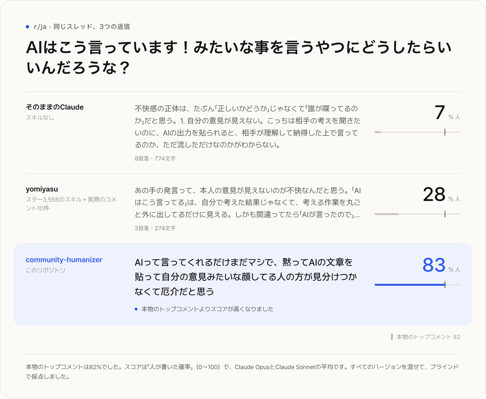
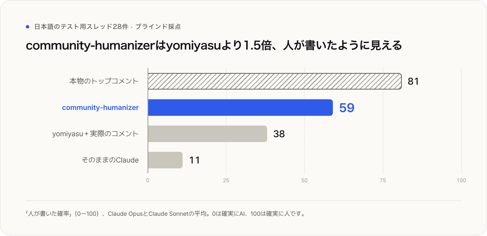

<h1 align="center">community-humanizer</h1>

<p align="center">
  <b>ふつうのhumanizerは、文章からAIっぽさを消します。<br>このスキルは、投稿先にいる常連が書いたような文章にします。</b>
</p>

<p align="center">
  Redditの返信を、subredditごとにそこの常連らしく書くClaude Codeのスキルです。投稿まではしません。
</p>

<p align="center">
  <a href="https://quiz.trina.app/?lang=ja"><picture><source media="(prefers-color-scheme: dark)" srcset="docs/img/quiz-ja-dark.png"></picture></a>
</p>

<p align="center">
  
  
  <a href="benchmark/"></a>
</p>

<p align="center">
  <a href="#同じスレッド3つの返信">例</a> ·
  <a href="#結果">結果</a> ·
  <a href="#インストール">インストール</a> ·
  <a href="#クイズ">クイズ</a>
</p>

<p align="center">
  <a href="README.md">English</a> · <a href="README.ko.md">한국어</a> · <b>日本語</b> · <a href="README.zh-CN.md">中文</a> · <a href="README.es.md">Español</a> · <a href="README.id.md">Bahasa</a>
</p>

---

## 同じスレッド、3つの返信

<picture>
  <source media="(prefers-color-scheme: dark)" srcset="docs/img/thread-ja-dark.png">
  
</picture>

<p align="center"><sub><a href="https://www.reddit.com/r/ja/comments/1y38epu/">元のスレッド</a> · スコアの出典：<a href="benchmark/japanese-comments/judged">benchmark/japanese-comments/judged</a></sub></p>

## 結果

<picture>
  <source media="(prefers-color-scheme: dark)" srcset="docs/img/scores-ja-dark.png">
  
</picture>

審査員はClaude OpusとClaude Sonnetの2つのAIです。どちらも1つのスレッドの返信をすべて同時に読み、返信ごとに人が書いた確率を0〜100でつけました。並び順は審査員ごとにランダムです。28件のスレッドはr/newsokur・r/lowlevelaware・r/ja・r/newsokunomoralから集めたもので、プロンプトの調整には1件も使っていません。スキルのプロンプトは英語のままで、日本語向けには1語も変えていません。比較対象は、日本語のhumanizerでいちばんスターが多い[yomiyasu](https://github.com/nanaism/yomiyasu)（スター3,556）です。yomiyasuには、同じsubredditの実際のコメント10件も一緒に渡しました。合格の基準は、テストの前に決めて書き残しています。審査員ごとのスコア、信頼区間、生成したすべての文章は[benchmark/japanese-comments/RESULTS.md](benchmark/japanese-comments/RESULTS.md)にあります。英語と韓国語のテストは[benchmark/RESULTS.md](benchmark/RESULTS.md)をご覧ください。

この数字ではわからないこと：
- **審査員はすべてAIです。** 人の答えはまだありません。そのために[クイズ](#クイズ)を用意しました。
- **GPTの審査員はいません。** 英語と韓国語のテストではGPTを含む3つの審査員を使いましたが、ここではClaude OpusとClaude Sonnetの2つだけです。
- **まだ本物には届きません。** 本物のトップコメントは平均81、community-humanizerは59です。本物より人らしいと判定されたのは、28件のうちOpusで2件、Sonnetで6件でした。
- **差が小さいsubredditもあります。** r/newsokunomoralでは、Sonnetの採点でyomiyasuをわずかに下回りました（−2.6）。全体ではどちらの審査員でもyomiyasuを上回っています（+24と+17、95%信頼区間はどちらも0より上）。
- **長い「回答」型の返信は弱いです。** 小さめのモデルが「回答」型の下書きを選んだ7件は平均35で、それ以外の21件は平均67でした。

## わかったこと

- **短いほうが勝ちます。** この28件では、本物のトップコメントの長さの中央値は50文字でした。そのままのClaudeは379文字、yomiyasuは104文字、community-humanizerは63文字です。
- **効果のほとんどは、1段落のペルソナから来ています。** 短く書き、頑張りすぎず、何でも知っているわけではなく、知ったかぶりもしない常連です（Jones & Bergen 2025を参考にしました）。この段落は[prompts.mjs](skills/community-humanizer/lib/prompts.mjs)にそのまま入っています。
- **審査員が「AIっぽい」と指摘した点を直すと、スコアは下がりました。** 英語のテストで、Opusは整いすぎた締めの一文と、わざとらしいくだけた口調を挙げました。まさにそこを消すと、12〜20点下がりました。審査員が口にする理由と、実際に見ているところは違います。
- **わざと誤字を入れても効果はありません。** 英語のテストでは、実際の投稿に誤字はほとんどありませんでした（1〜2%）。効いたのは、スマホで打つように、思いついた順に書くことでした。

## しないこと

- **代わりに投稿しません。** 下書きを読み、自分に当てはまらないところを直してから、自分で投稿してください。
- **経験をでっち上げません。** 自分の経験は`--fact "..."`（返信）かメモ（投稿）で渡したものだけを使います。投稿はメモと照らし合わせて確認します。
- **政治のスレッドには書きません。** まず小さなモデルが確認し、政治ではないとはっきりしないものは断ります。
- **AIの文章を禁止している場所には書きません。** subredditごとのプロフィールにルールが入っています。AIによる文章を禁止しているsubreddit（例：r/askspain）では書くのを断り、宣伝に関するルールは投稿の前に表示します。

## インストール

| エージェント | インストール |
| --- | --- |
| **Claude Code** | `/plugin marketplace add trina-app/community-humanizer`の後に`/plugin install community-humanizer@community-humanizer` |
| **Codex・Cursor・Gemini CLI・Copilot**など、[Agent Skills](https://agentskills.io)に対応したエージェント | `npx skills add trina-app/community-humanizer -g` |
| **コマンドを実行できるエージェントならどれでも** | 下のプロンプトを貼り付け |

```text
Set up community-humanizer for me: clone https://github.com/trina-app/community-humanizer,
read skills/community-humanizer/SKILL.md, and follow it whenever I ask for a Reddit reply or post.
```

あとは「このスレッドに返信を書いて：<url>」「r/jaに〇〇についての投稿を書いて」のように頼むだけです。

どのエージェントで使う場合も、Node 18以上と[Claude Code](https://claude.com/claude-code)が必要です。下書きを`claude -p`の呼び出しで書くため、Claude Codeはインストールしてサインインしておいてください。

<details>
<summary>リポジトリをcloneしてターミナルから使う場合</summary>

```bash
node skills/community-humanizer/bin/voice.mjs reply <redditのスレッドURL> [--point "言いたいこと"]
node skills/community-humanizer/bin/voice.mjs post --to r/selfhosted --title "Is a Mac mini enough for Immich?" --notes "400GB of photos, M2 mini 16GB unused, also Jellyfin for 3 people, macOS or Linux on an old PC?"
```

</details>

## しくみ

**返信**
1. 無料のアーカイブ[Arctic Shift](https://arctic-shift.photon-reddit.com)から、同じsubredditで直近2週間に盛り上がったスレッドを10件ほど読みます。返信するスレッド自体はサンプルに使いません。
2. 上位のコメントを種類ごとに分けます：回答・一言・反論・聞き返し・余談・冗談・愚痴。
3. そのsubredditでの実際の割合に合わせて種類を3つ選び、種類ごとに下書きを1つずつ書きます。下書きごとにClaudeを別々に呼び出し、同じ種類の実際のコメントを例として渡します。
4. 小さめのモデルが、いちばん常連らしいものを選びます。残りの2つも一緒に表示します。

ペルソナは、3者間のチューリングテストでGPT-4.5が73%の割合で人間と判定されたときのものを手直ししました（[Jones & Bergen, 2025](https://arxiv.org/abs/2503.23674)）。元のテストはチャットだったので、掲示板の返信向けに書き直し、ブラインドで測りました（結果は上のとおりです）。

**投稿**：言いたいことをメモで渡すと、そのsubredditの実際の投稿6件をもとに、常連がスマホで打つような投稿を書きます。メモにない内容が入っていないかも確認します。

**コストと時間**：返信1件（下書き3つと選択）は、Opusが書くと約$0.07で13秒ほど、`--fast`（Sonnet）なら約$0.04です。Claude Codeが表示するAPI価格をもとにしています。初めて使うsubredditでは、読み込みと分類に1分ほどかかり、結果は1週間キャッシュします。

## クイズ

**ここで遊べます：[quiz.trina.app](https://quiz.trina.app/?lang=ja)**

日本語版は全10問で、テストに使ったスレッドから出題します。各問題には返信が2つあり、片方は人が書いたものです。最後に自分のスコアと、ほかの人の正解率が表示されます。

回答は匿名で保存します（ランダムなセッションIDのみで、IPアドレスは保存しません）。人がどのくらい見分けられるのかを、ようやく数字で示すためです。コードは[quiz/](quiz/)にあります。

## コミュニティのプロフィール

subredditごとに、[communities/](communities/)に小さなプロフィールがあります。コメントの種類ごとの割合、コメントと投稿の長さ、気をつけるべきルールが入っています。追加はコマンド1つとルールページの確認だけです。手順は[communities/README.md](communities/README.md)を見て、PRで送ってください。

## ベンチマーク

[benchmark/](benchmark/)には7つのテスト（英語・日本語・中国語・スペイン語・インドネシア語のReddit返信、韓国語のClien返信、英語と韓国語の投稿）があります。テストごとに、事前に書いたプロトコルとスクリプト、生成したすべての文章、各審査員のスコアを置いています。実際のコメントと投稿は書いた人のものなので再配布せず、`ids.json`に元のスレッドへのリンクを置いています。自分のhumanizerを同じスレッドで試したい場合は、出力をPRで送ってください。

## コントリビュート

次のようなPRを歓迎します：
- **subreddit**：[communities/](communities/)にプロフィールを1つ（コマンド1つとルールページの確認だけです）。
- **言語**：その言語でのブラインドテスト。[benchmark/indonesian-comments/](benchmark/indonesian-comments/)と同じ形です。母語の方なら、READMEとクイズの文言も歓迎します。
- **Reddit以外のコミュニティ**：[lib/clien.mjs](skills/community-humanizer/lib/clien.mjs)のような読み込み部分、プロフィール、調整に使っていないスレッドでのテスト。

詳しくは[CONTRIBUTING.md](CONTRIBUTING.md)をご覧ください。

## ライセンス

MIT
