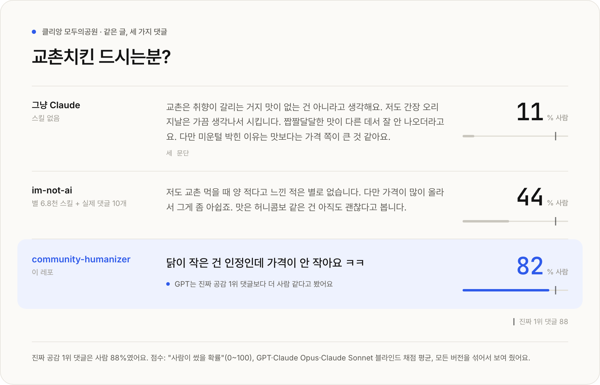
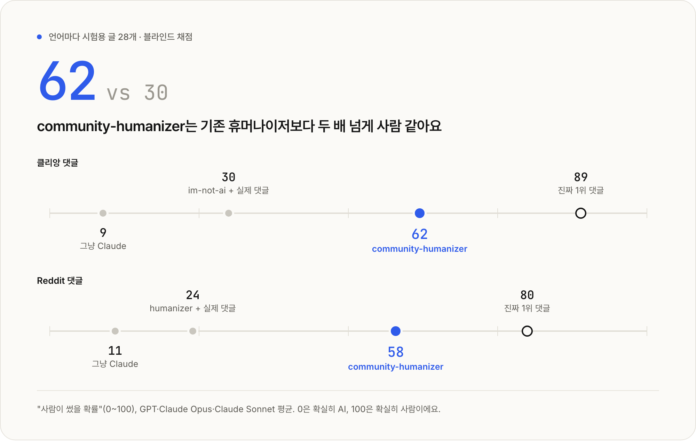

<h1 align="center">community-humanizer</h1>

<p align="center">
  <b>AI 티만 빼는 게 아니라, 그 커뮤니티 사람처럼 써요.</b>
</p>

<p align="center">
  클리앙과 Reddit 댓글을 그곳 단골들이 쓰는 말투로 써 주는 Claude Code 스킬이에요. 대신 올려 주지는 않아요.
</p>

<p align="center">
  <a href="https://quiz.trina.app/?lang=ko"></a>
</p>

<p align="center">
  
  
  <a href="benchmark/"></a>
</p>

<p align="center">
  <a href="#같은-글-세-가지-댓글">예시</a> ·
  <a href="#사람-같은지-채점한-결과">채점 결과</a> ·
  <a href="#설치">설치</a> ·
  <a href="#퀴즈">퀴즈</a> ·
  <a href="README.md">English</a>
</p>

---

## 같은 글, 세 가지 댓글

<picture>
  <source media="(prefers-color-scheme: dark)" srcset="docs/img/thread-ko-dark.png">
  
</picture>

<p align="center"><sub>[원문](https://www.clien.net/service/board/park/19296644) · 점수 출처 [benchmark/korean-comments/judged](benchmark/korean-comments/judged)</sub></p>

## 사람 같은지 채점한 결과

<picture>
  <source media="(prefers-color-scheme: dark)" srcset="docs/img/scores-ko-dark.png">
  
</picture>

채점자 셋(GPT, Claude Opus, Claude Sonnet)에게 한 글의 모든 버전을 한꺼번에, 채점자마다 다른 순서로 섞어서 보여 줬어요. 버전마다 "사람이 썼을 확률"(0~100)을 매겼어요. 숫자는 모두 프롬프트를 고칠 때 쓰지 않은 글(언어마다 28개)에서 나왔고, 통과 기준은 시험 전에 적어 뒀어요. 채점자별 점수, 글 시험, 신뢰 구간, 생성 결과는 [benchmark/RESULTS.ko.md](benchmark/RESULTS.ko.md)에 있어요.

이 숫자로 말할 수 없는 것도 있어요.
- **채점자는 모두 AI예요.** 아직 사람의 답은 없어요. 그래서 [퀴즈](#퀴즈)로 모아요.
- **긴 글은 더 어려워요.** Sonnet은 영어 글을 진짜 글과 구별하지 못했지만(63 대 65), Opus와 GPT는 대부분 알아봐요.
- **사람 같은 것과 도움이 되는 것은 달라요.** "어느 쪽에 공감을 누르겠냐"고 물으면 채점자들은 더 긴 im-not-ai·humanizer 쪽을 더 자주 골랐어요.

## 알게 된 것

- **짧고 대충 쓴 게 이겨요.** AI는 10단어 이하 답을 448개 중 1개만 썼어요. 실제 1위 댓글은 14%가 그 길이예요.
- **페르소나 한 문단이 거의 전부를 했어요.** 다 아는 척하지 않고 애쓰지 않는 단골이에요(Jones & Bergen 2025 참고). 그 문단은 [prompts.mjs](skills/community-humanizer/lib/prompts.mjs)에 그대로 있어요.
- **채점자가 "이게 AI 티"라고 말한 걸 고쳤더니 12~20점 떨어졌어요.** 채점자가 대는 이유와 실제 판단 기준은 달라요.
- **일부러 오타를 넣는 건 효과가 없어요.** 실제 글에도 오타는 1~2%뿐이에요. 통한 건 폰으로 빨리 치고 다시 안 읽는 방식이었어요.

## 하지 않는 것

- **대신 올리지 않아요.** 직접 읽고, 사실과 다른 데를 고친 다음 올리세요.
- **겪지 않은 일을 지어내지 않아요.** 내 경험은 `--fact "..."`(댓글)나 메모(글)로 직접 넣은 것만 쓰고, 글은 메모와 대조해서 확인해요.
- **정치 글은 쓰지 않아요.** 작은 모델이 먼저 확인하고, "정치 아님"이 분명하지 않으면 거절해요.
- **AI 글을 금지한 곳에는 쓰지 않아요.** 커뮤니티 프로필에 규칙이 들어 있어서, AI 글 금지인 곳은 거절하고 홍보 규칙은 올리기 전에 알려 줘요.

## 설치

| 에이전트 | 설치 |
| --- | --- |
| **Claude Code** | `/plugin marketplace add trina-app/community-humanizer` 다음 `/plugin install community-humanizer@community-humanizer` |
| **Codex, Cursor, Gemini CLI, Copilot** 등 [Agent Skills](https://agentskills.io) 지원 에이전트 | `npx skills add trina-app/community-humanizer -g` |
| **명령어를 실행할 수 있는 모든 에이전트** | 아래 문장을 붙여 넣기 |

```text
community-humanizer를 설치해 줘: https://github.com/trina-app/community-humanizer 를 받아서
skills/community-humanizer/SKILL.md 를 읽고, 내가 Reddit이나 클리앙 댓글·글을 부탁하면 그대로 따라 줘.
```

그다음 "이 글에 댓글 써 줘: <주소>"나 "클리앙 아무거나질문에 올릴 글 써 줘"처럼 말하면 돼요.

어떤 에이전트로 쓰든 Node 18 이상과 [Claude Code](https://claude.com/claude-code) 로그인이 필요해요. 초안은 `claude -p` 호출로 쓰거든요.

<details>
<summary>레포를 받아서 터미널에서 직접 쓸 때</summary>

```bash
node skills/community-humanizer/bin/voice.mjs reply <reddit 또는 클리앙 글 주소> [--point "하고 싶은 말"]
node skills/community-humanizer/bin/voice.mjs post --to clien/kin --title "맥미니로 집 서버 돌리시는 분 계신가요?" --notes "사진 400GB, 안 쓰는 M2 맥미니 16GB, 가족 3명 Immich·Jellyfin, 리눅스가 나은지 궁금"
```

</details>

## 작동 방식

**댓글**
1. 같은 커뮤니티에서 최근 2주 동안 댓글이 많았던 글 10개쯤을 읽어요. Reddit은 무료 아카이브 [Arctic Shift](https://arctic-shift.photon-reddit.com)에서, 클리앙은 공개 페이지에서 읽어요. 답할 글에 달린 댓글은 샘플로 쓰지 않아요.
2. 상위 댓글을 유형별로 나눠요. 유형은 긴 답, 한 줄, 반박, 되묻기, 딴 얘기, 농담, 불평이에요.
3. 그 커뮤니티의 실제 비율대로 유형 3개를 뽑아 초안을 하나씩 써요. 초안마다 같은 유형의 실제 댓글을 샘플로 주고, 서로 안 보게 따로 써요.
4. 작은 모델이 가장 사람 같은 하나를 골라요. 나머지 둘도 같이 보여 줘요.

페르소나는 3자 튜링 테스트에서 GPT-4.5가 73% 확률로 사람 판정을 받게 한 페르소나([Jones & Bergen, 2025](https://arxiv.org/abs/2503.23674))를 바꿔서 썼어요. 그 시험은 채팅이었어요. 그래서 커뮤니티 댓글에 맞게 다시 쓰고, 블라인드로 쟀어요(결과는 위에 있어요).

**글:** 하고 싶은 말을 메모로 주면, 그 커뮤니티 실제 글 6개를 보고 단골이 폰으로 치듯 써요. 메모에 없는 내용이 들어갔는지도 한 번 더 확인해요.

**비용과 시간:** 댓글 하나(초안 3개 + 고르기)는 Opus가 쓰면 약 $0.07에 13초, `--fast`(Sonnet)로 쓰면 약 $0.04예요. Claude Code가 보여 주는 API 가격 기준이에요. 처음 쓰는 커뮤니티는 읽고 나누는 데 1분쯤 걸리고, 그 결과를 일주일 동안 저장해 둬요.

## 퀴즈

**바로 풀기: [quiz.trina.app](https://quiz.trina.app/?lang=ko)**

시험에 쓴 글에서 10문제가 나와요. 댓글이나 글 두 개 중 하나는 사람이 썼어요. 다 풀면 내 점수와 다른 사람들이 맞힌 비율을 보여 줘요.

사람이 얼마나 알아보는지 알리려고 답을 익명으로 저장해요. 무작위 세션 번호만 남기고, IP는 저장하지 않아요. 코드는 [quiz/](quiz/)에 있어요.

## 커뮤니티 프로필

커뮤니티마다 [communities/](communities/) 폴더에 작은 프로필 파일이 있어요. 댓글 유형 비율, 댓글과 글 길이, 지켜야 할 규칙이 들어 있어요. 하나 추가하는 데는 명령어 하나와 규칙 페이지 확인이면 돼요. 방법은 [communities/README.md](communities/README.md)에 있고, PR로 보내 주세요.

## 벤치마크

[benchmark/](benchmark/)에는 시험 세 개(영어 Reddit 댓글, 한국어 클리앙 댓글, 두 언어의 글)가 있어요. 시험마다 시험 전에 적은 기준, 대본, 생성 결과, 채점 점수가 들어 있어요. 실제 댓글과 글은 쓴 사람의 것이라 넣지 않았고, `ids.json`에 원문 링크를 뒀어요. 내 휴머나이저도 같은 글로 재 보고 싶으면 결과를 PR로 보내 주세요.

## 라이선스

MIT
