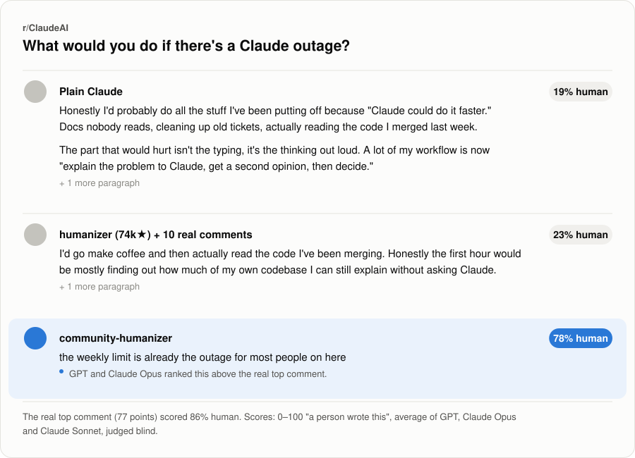
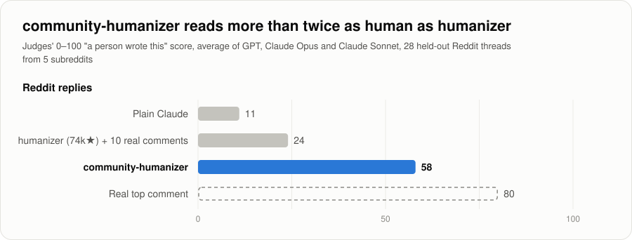

<h1 align="center">community-humanizer</h1>

<p align="center">
  <b>Humanizers make text sound less like AI.<br>This makes it sound like the people who actually hang out there.</b>
</p>

<p align="center">
  A Claude Code skill that writes Reddit replies the way each subreddit's regulars do. It never posts.
</p>

<p align="center">
  <a href="#quiz"></a>
</p>

<p align="center">
  
  
  <a href="benchmark/"></a>
</p>

<p align="center">
  <a href="#same-thread-three-writers">Example</a> ·
  <a href="#does-it-work">Benchmark</a> ·
  <a href="#install">Install</a> ·
  <a href="#quiz">Quiz</a> ·
  <a href="README.ko.md">한국어</a>
</p>

---

## Same thread, three writers

<picture>
  <source media="(prefers-color-scheme: dark)" srcset="docs/img/thread-en-dark.svg">
  
</picture>

<p align="center"><sub>[The thread](https://www.reddit.com/r/ClaudeAI/comments/1xuzlpu/) · scores from [benchmark/reddit-comments/judged-F1](benchmark/reddit-comments/judged-F1)</sub></p>

## Does it work?

<picture>
  <source media="(prefers-color-scheme: dark)" srcset="docs/img/scores-en-dark.svg">
  
</picture>

Three AI judges saw every version of a reply at once, each in its own shuffled order, and gave each a 0–100 chance that a person wrote it. The 28 threads come from r/smallbusiness, r/SaaS, r/selfhosted, r/ClaudeAI and r/startups, and none of them was used while tuning the prompts. The pass rule was written down before the run. Per-judge scores, posts, intervals and every generated text: [benchmark/RESULTS.md](benchmark/RESULTS.md).

What this doesn't show:
- **The judges are all LLMs.** We have no human answers yet. That is what the [quiz](#quiz) is for.
- **Posts are harder.** Sonnet couldn't tell our posts from the real ones (63 vs 65), but Opus and GPT still spot most of them.
- **Human-like is not helpful.** Asked which reply they would upvote, the judges more often picked the longer humanizer replies.

## What we learned

- **Short beats polished.** AI almost never wrote 10 words or fewer (1 of 448 replies). 14% of real top comments do.
- **One paragraph did most of the work.** A behaviour persona: short, low effort, doesn't know everything and doesn't pretend to (after Jones & Bergen 2025). It's in [prompts.mjs](skills/community-humanizer/lib/prompts.mjs).
- **Fixing what the judge said gave it away made scores worse.** Opus named tidy closers and fake casualness; removing exactly those cost 12–20 points.
- **Fake typos don't help.** Real posts have almost none (1–2%). Writing the way someone types on a phone, in the order things come to mind, did.

## What it won't do

- **Post for you.** You read the draft, fix anything that isn't true for you, and post it yourself.
- **Invent experience.** Your own story goes in only through `--fact "..."` or your notes, and posts are checked against your notes.
- **Write political threads.** A small model checks first; anything not clearly non-political is refused.
- **Write where AI text is banned.** Each subreddit profile carries its rules. It refuses subreddits that ban AI-written content and shows the self-promotion rules before you post.

## Install

| Agent | Install |
| --- | --- |
| **Claude Code** | `/plugin marketplace add trina-app/community-humanizer` then `/plugin install community-humanizer@community-humanizer` |
| **Codex, Cursor, Gemini CLI, Copilot** and other [Agent Skills](https://agentskills.io) hosts | `npx skills add trina-app/community-humanizer -g` |
| **Any agent that can run commands** | Paste the prompt below |

```text
Set up community-humanizer for me: clone https://github.com/trina-app/community-humanizer,
read skills/community-humanizer/SKILL.md, and follow it whenever I ask for a Reddit reply or post.
```

Then ask in plain words: "write a reply to this thread: <url>" or "write a post for r/selfhosted about ...".

Whichever agent you use, it needs Node 18+ and [Claude Code](https://claude.com/claude-code) installed and signed in: the drafts are written by `claude -p` calls.

<details>
<summary>From a clone, in a terminal</summary>

```bash
node skills/community-humanizer/bin/voice.mjs reply <reddit post url> [--point "what you want to say"]
node skills/community-humanizer/bin/voice.mjs post --to r/selfhosted --title "Is a Mac mini enough for Immich?" --notes "400GB of photos, M2 mini 16GB unused, also Jellyfin for 3 people, macOS or Linux on an old PC?"
```

</details>

## How it works

**Replies**
1. It reads about ten busy threads from the same subreddit in the last two weeks, through the free [Arctic Shift](https://arctic-shift.photon-reddit.com) archive. The thread you're answering is never used as a sample.
2. It labels their top comments by kind: answer, one-liner, disagree, question back, side point, joke, complaint.
3. It draws three kinds at that subreddit's real rates and writes one draft of each, each in a separate Claude call with real comments of that kind as samples.
4. A smaller model picks the one that reads most like a regular. You get the other two as well.

**Posts:** you give the point as notes. It writes the post the way a regular types it on a phone, from six real posts in that subreddit, then checks that nothing in the post goes beyond your notes.

**Cost and time:** one reply (three drafts and the pick) is about $0.07 and 13 seconds with Opus writing, or $0.04 with `--fast` (Sonnet), at the API prices Claude Code reports. The first time in a subreddit, reading and labelling it takes about a minute and is cached for a week.

## Quiz

Ten questions from the held-out sets: two versions of a reply or a post, and a person wrote one of them. At the end you see your score and how everyone else did.

Answers are stored anonymously (a random session id, no IP), so we can finally report how often people can tell. The code is in [quiz/](quiz/).

## Subreddits

Each subreddit has a small profile in [communities/](communities/): how often each kind of comment shows up, how long comments and posts are, and the rules that matter. Adding one takes a command and a look at the rules page. See [communities/README.md](communities/README.md) and send it as a PR.

## Benchmark

[benchmark/](benchmark/) holds the protocol written before each run, the scripts, every generated text and every judge's score. The real comments and posts are not redistributed; `ids.json` links to each source thread. Want to test your own humanizer on the same threads? Open a PR with its outputs.

## License

MIT
