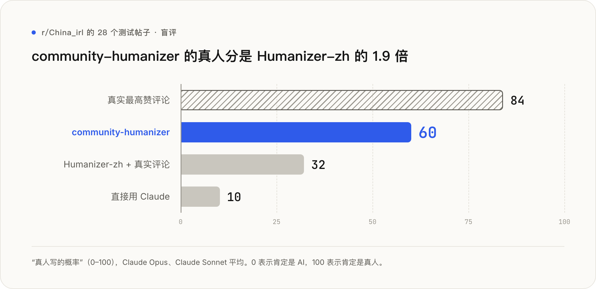

<h1 align="center">community-humanizer</h1>

<p align="center">
  <b>别的 humanizer 只是让文字少点 AI 味。<br>这个让回复读起来像版块里的老用户写的。</b>
</p>

<p align="center">
  一个 Claude Code 技能，照着每个 subreddit 老用户的写法写 Reddit 回复。不会替你发帖。
</p>

<p align="center">
  <a href="https://quiz.trina.app/?lang=zh"><picture><source media="(prefers-color-scheme: dark)" srcset="docs/img/quiz-zh-dark.png"></picture></a>
</p>

<p align="center">
  
  
  <a href="benchmark/"></a>
</p>

<p align="center">
  <a href="#三种回复对比">示例</a> ·
  <a href="#效果如何">测评</a> ·
  <a href="#安装">安装</a> ·
  <a href="#答题">答题</a>
</p>

<p align="center">
  <a href="README.md">English</a> · <a href="README.ko.md">한국어</a> · <a href="README.ja.md">日本語</a> · <b>中文</b> · <a href="README.es.md">Español</a> · <a href="README.id.md">Bahasa</a>
</p>

---

## 三种回复对比

<picture>
  <source media="(prefers-color-scheme: dark)" srcset="docs/img/thread-zh-dark.png">
  
</picture>

<p align="center"><sub><a href="https://www.reddit.com/r/China_irl/comments/1xmd3vj/">原帖</a> · 分数来自 <a href="benchmark/chinese-comments/judged">benchmark/chinese-comments/judged</a></sub></p>

## 效果如何

<picture>
  <source media="(prefers-color-scheme: dark)" srcset="docs/img/scores-zh-dark.png">
  
</picture>

两个 AI 评委（Claude Opus、Claude Sonnet）一次看到同一个帖子下的所有回复，顺序按评委各自打乱。评委给每条回复估一个 0–100 的“真人写的概率”。28 个帖子来自 r/China_irl，调提示词时一个都没用过。技能的提示词是英文的，没有为中文改过一个字。对照组是中文 humanizer 里 Star 最多的 [Humanizer-zh](https://github.com/op7418/Humanizer-zh)（约 2.4 万 Star），同样附上这个版块的 10 条真实评论。通过标准在测试前就写好了。每个评委的分数、置信区间和全部生成结果见 [benchmark/chinese-comments/RESULTS.md](benchmark/chinese-comments/RESULTS.md)，英文和韩文测试见 [benchmark/RESULTS.md](benchmark/RESULTS.md)。

这些数字说明不了的：
- **评委都是 AI。** 还没有真人的判断，[答题](#答题)就是为这个做的。
- **没有 GPT 评委。** 测试方案原本写的是三个评委，GPT 因为用量上限没有跑，所以这里只有 Claude Opus 和 Claude Sonnet 的结果。两个评委下 community-humanizer 都高于 Humanizer-zh（高 32 分和 24 分，95% 区间都在 0 以上）。
- **多数时候还是能被认出来。** 真实最高赞评论平均 84 分，community-humanizer 是 60 分。28 个帖子里，每个评委各只有 2 次觉得它比真实评论更像真人。
- **话题比较集中。** 28 个帖子里至少有 11 个在聊同一条新闻（英伟达 CEO 的风波）。
- **只测了一个版块。** r/China_irl 是最大的中文 subreddit。其他中文社区（比如 V2EX、贴吧）还没测，工具目前也只支持 Reddit 和 Clien。

## 几点发现

- **短比精致更管用。** 在这 28 个帖子里，真实最高赞评论的中位长度是 70 个字。直接让 Claude 写是 476 个字，Humanizer-zh 是 183 个字，community-humanizer 是 57 个字。
- **一段人设起了大部分作用。** 写的是行为方式：话少、不费劲、不是什么都懂，也不装懂（参考 Jones & Bergen 2025）。这段话原样放在 [prompts.mjs](skills/community-humanizer/lib/prompts.mjs) 里。
- **照评委指出的“AI 痕迹”去改，分数反而掉了。** 在英文测试里，Opus 点名了工整的结尾和刻意的随意感，专门去掉这几处后，分数少了 12–20 分。评委说的理由和它真正的判断依据不是一回事。
- **故意加错别字没用。** 在英文测试里，真实帖子几乎没有错别字（1–2%）。有用的是像在手机上打字那样，想到哪写到哪。

## 不会做的事

- **不替你发帖。** 先读一遍草稿，把和你实际情况不符的地方改掉，再自己发。
- **不编造经历。** 你自己的经历只能通过 `--fact "..."`（回复）或笔记（帖子）放进去，帖子写完还会和笔记核对一遍。
- **不写政治帖。** 先由一个小模型检查，不能明确判断为非政治的一律拒绝。
- **不在禁止 AI 内容的版块写。** 每个版块的配置里都带着它的规则。禁止 AI 内容的版块直接拒绝（比如 r/askspain）；推广相关的规则和其他注意事项会在你发帖前列出来，比如 r/China_irl 要求主动声明 AI 生成的内容。

## 安装

| 工具 | 安装方式 |
| --- | --- |
| **Claude Code** | `/plugin marketplace add trina-app/community-humanizer`，然后 `/plugin install community-humanizer@community-humanizer` |
| **Codex、Cursor、Gemini CLI、Copilot** 等支持 [Agent Skills](https://agentskills.io) 的工具 | `npx skills add trina-app/community-humanizer -g` |
| **任何能执行命令的 Agent** | 粘贴下面这段话 |

```text
Set up community-humanizer for me: clone https://github.com/trina-app/community-humanizer,
read skills/community-humanizer/SKILL.md, and follow it whenever I ask for a Reddit reply or post.
```

装好后直接说就行：“帮我回复这个帖子：<链接>”，或者“帮我写一篇发到 r/selfhosted 的帖子，内容是……”。

不管用哪个工具，都需要 Node 18 以上，还要装好 [Claude Code](https://claude.com/claude-code) 并登录，草稿是靠 `claude -p` 调用写出来的。

<details>
<summary>克隆仓库后在终端里直接用</summary>

```bash
node skills/community-humanizer/bin/voice.mjs reply <reddit 帖子链接> [--point "你想表达的观点"]
node skills/community-humanizer/bin/voice.mjs post --to r/selfhosted --title "Is a Mac mini enough for Immich?" --notes "400GB of photos, M2 mini 16GB unused, also Jellyfin for 3 people, macOS or Linux on an old PC?"
```

</details>

## 工作原理

**回复**
1. 通过免费的 [Arctic Shift](https://arctic-shift.photon-reddit.com) 存档，读取同一个 subreddit 最近两周的 10 个左右热帖。你要回复的帖子不会用作样本。
2. 给这些帖子里的高赞评论分类：解答、一句话、反驳、反问、题外话、玩笑、吐槽。
3. 按这个版块的实际比例抽出 3 种类型，每种写一条草稿。每条草稿单独调用一次 Claude，并附上同类型的真实评论作为样本。
4. 再用一个小一点的模型挑出最像老用户写的那条，另外两条也一并给你。

人设改编自一项三方图灵测试（[Jones & Bergen, 2025](https://arxiv.org/abs/2503.23674)）：GPT-4.5 用上原版人设后，判为真人的比例达到 73%。那是聊天测试，我们把它改写成论坛回复的版本，并做了盲测（结果见上文）。

**帖子：** 把要说的内容写成笔记就行。参照这个版块的 6 篇真实帖子，按老用户用手机打字的样子写出帖子，最后检查有没有超出笔记的内容。

**成本和时间：** 一条回复（3 条草稿加挑选）用 Opus 写约 $0.07、13 秒，用 `--fast`（Sonnet）约 $0.04，按 Claude Code 显示的 API 价格计算。第一次在某个版块使用时，读取和分类要 1 分钟左右，结果缓存一周。

## 答题

**直接玩：[quiz.trina.app](https://quiz.trina.app/?lang=zh)**

中文题来自 r/China_irl 的测试帖子，去掉了涉及政治和具体人物新闻的帖子，目前只有 3 题：每题两条回复，其中一条是真人写的。答完能看到你的得分，以及其他人的正确率。

答案匿名保存（只有一个随机会话 ID，不存 IP），这样我们终于能统计出人能认出来的比例。代码在 [quiz/](quiz/)。

## 版块配置

每个 subreddit 在 [communities/](communities/) 里都有一个小配置：各类评论出现的比例、评论和帖子的长度，以及需要注意的规则。新增一个版块只需要跑一条命令，再看一眼规则页。方法见 [communities/README.md](communities/README.md)，欢迎提 PR。

## 测评

[benchmark/](benchmark/) 里有每次测试前写好的方案、脚本、所有生成结果和每个评委的打分。真实的评论和帖子不随仓库分发，`ids.json` 里有每个原帖的链接。想用同样的帖子测你自己的 humanizer？欢迎把输出结果提个 PR。

## 参与贡献

欢迎提 PR：
- **新的 subreddit**：在 [communities/](communities/) 里加一个配置（一条命令，再看一眼规则页）。
- **新的语言**：用这门语言做一次盲测，做法参考 [benchmark/indonesian-comments/](benchmark/indonesian-comments/)。如果这是你的母语，也欢迎补上 README 和答题文案。
- **Reddit 以外的社区**：一个像 [lib/clien.mjs](skills/community-humanizer/lib/clien.mjs) 这样的读取模块、一份配置，以及一次用没参与调试的帖子做的测试。

详见 [CONTRIBUTING.md](CONTRIBUTING.md)。

## 开源协议

MIT
